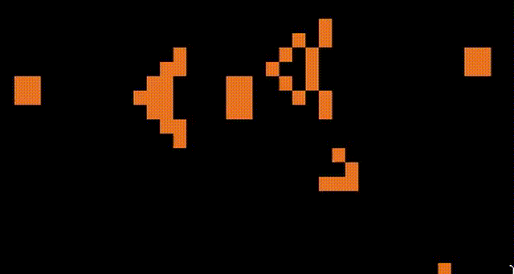
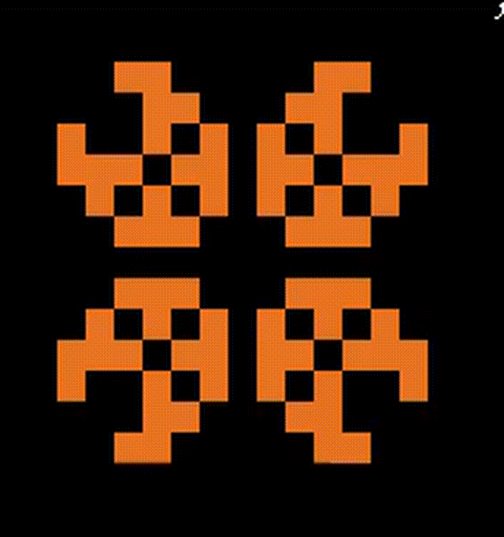
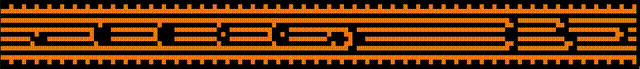

# nix-life

Conway's Game of Life, written in pure Nix and played in your terminal.

The rules, the grid stepping and the rendering are all Nix expressions. A small shell wrapper evaluates one generation at a time and redraws the screen.

## Showcase

Every pattern below is a ready-made package in the flake.



```sh
nix run github:preprocessor/nix-life#gosper
```

### Pulsar



```sh
nix run github:preprocessor/nix-life#pulsar
```

### Achim's p16 variant


```sh
nix run github:preprocessor/nix-life#achimsotherp16variant
```

### Zebra wires



```sh
nix run github:preprocessor/nix-life#zebra_wires
```

## Usage

You need [Nix](https://nixos.org/download) with flakes enabled (`experimental-features = nix-command flakes`) and a terminal that supports ANSI escapes and Unicode block characters.

| Command | Pattern | Frame delay | Edges |
| --- | --- | --- | --- |
| `nix run github:preprocessor/nix-life` | Gosper glider gun (default) | 0.02 s | dead |
| `nix run github:preprocessor/nix-life#gosper` | Gosper glider gun | 0.02 s | dead |
| `nix run github:preprocessor/nix-life#pulsar` | Pulsar | 0.1 s | dead |
| `nix run github:preprocessor/nix-life#achimsotherp16variant` | Achim's p16 variant | 0.1 s | dead |
| `nix run github:preprocessor/nix-life#zebra_wires` | Zebra wires | 0.02 s | wrap around |

Press `Ctrl-C` to stop. To run from a local checkout, use `nix run .#pulsar` and so on.

## Run your own pattern

`run.nix` takes four arguments:

| Argument | Default | Meaning |
| --- | --- | --- |
| `init_state` | required | The starting grid, a list of rows, each a list of `0` (dead) and `1` (alive) |
| `delay` | `0.0` | Seconds to sleep between generations |
| `wrap` | `false` | Whether the grid wraps around at the edges |
| `pkgs` | `import <nixpkgs> { }` | The package set used for the wrapper's dependencies |

Save this as `my-life.nix`, a glider on a wrapping 9×9 grid:

```nix
import ./run.nix {
  init_state = [
    [ 0 0 0 0 0 0 0 0 0 ]
    [ 0 0 1 0 0 0 0 0 0 ]
    [ 0 0 0 1 0 0 0 0 0 ]
    [ 0 1 1 1 0 0 0 0 0 ]
    [ 0 0 0 0 0 0 0 0 0 ]
    [ 0 0 0 0 0 0 0 0 0 ]
    [ 0 0 0 0 0 0 0 0 0 ]
    [ 0 0 0 0 0 0 0 0 0 ]
    [ 0 0 0 0 0 0 0 0 0 ]
  ];
  delay = 0.1;
  wrap = true;
}
```

Then build and run it:

```sh
nix-build my-life.nix && ./result/bin/run
```
To add a pattern to the flake itself, define the grid in the `let` block of `flake.nix` and add an entry to `packages` that calls `run.nix` with it, the same way the existing patterns do.

## How it works

The project is three small files.

- **`life.nix`** is the game itself. Given a `grid` and a `wrap` flag it exposes two things: `step`, the next generation, and `render`, the current generation as a string. A cell is alive in the next generation if it has exactly three live neighbours, or if it is alive now and has exactly two. Neighbour lookups treat everything outside the grid as dead, or wrap around when `wrap` is set.
- **`run.nix`** is the driver. It builds a shell application that loops forever: it hands the current grid to `nix-instantiate --eval --strict --json` through an environment variable, gets back `{ frame, next }`, clears the screen and prints the frame, then feeds `next` back in as the new state. `jq` does the JSON plumbing and `delay` controls the pacing.
- **`flake.nix`** holds the starting grids and exposes one package per pattern (`gosper`, `pulsar`, `achimsotherp16variant`, `zebra_wires`) for every system `nixpkgs` supports, with `gosper` as the default.

Rendering packs two grid rows into each terminal line using half-block characters (`▀`, `▄`, `█`), so cells come out roughly square and a grid takes half as many lines on screen.
